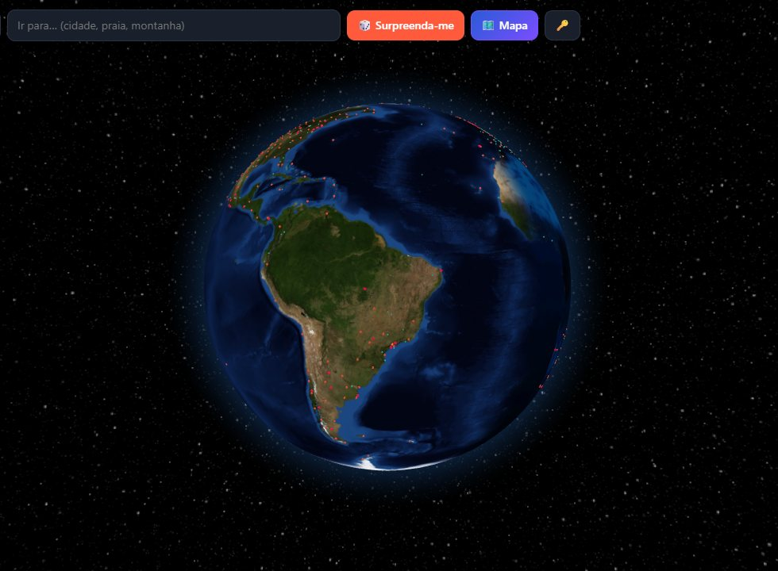
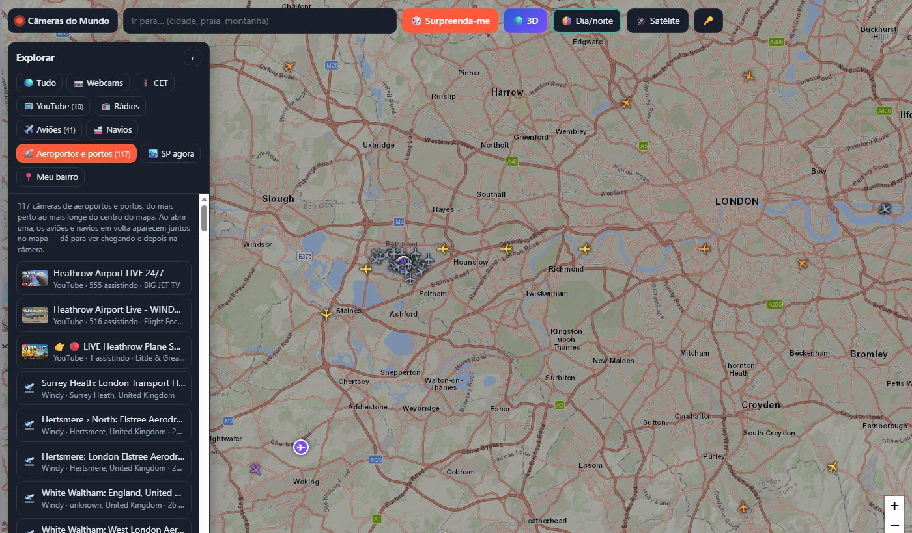
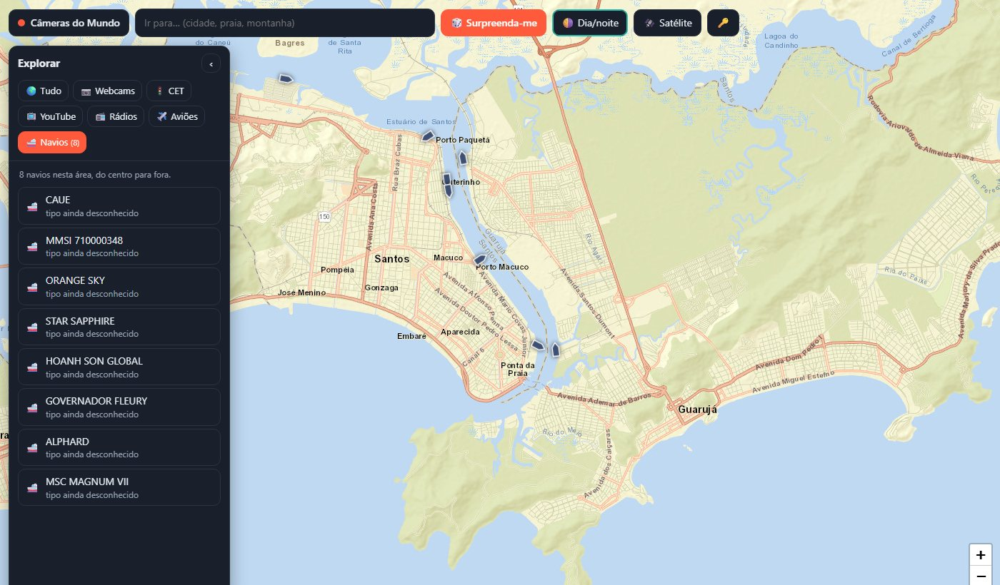
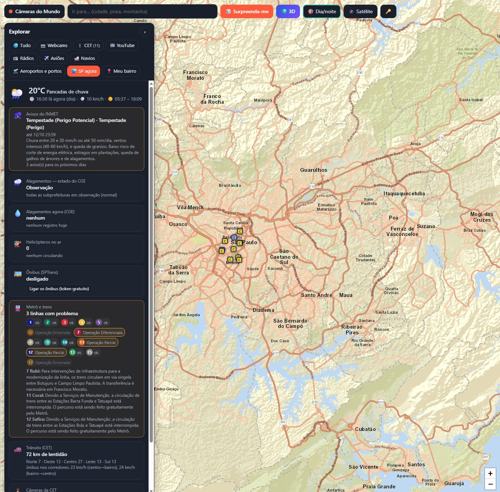

# CameraWeb

**Passear pelo mundo ao vivo, no seu navegador.** Um mapa (ou um planeta em 3D) cheio de câmeras abertas, rádios,
aviões e navios em tempo real: escolha um lugar, veja o que está acontecendo lá agora, ouça a rádio local e
acompanhe quem está chegando pelo céu ou pelo mar. E, para São Paulo, um painel da cidade agora e um alerta para o
seu bairro.

Tudo em português, com fontes públicas e gratuitas.



## O que dá para fazer

- **Ver dezenas de milhares de câmeras ao vivo** pelo mundo: praias, montanhas, cidades, estradas. Cada câmera abre
  com o vídeo das últimas horas, o tempo e a hora local e as rádios daquele lugar.
- **Ouvir rádios do mundo todo:** clique numa cidade e ouça a rádio local enquanto olha a câmera.
- **Acompanhar aviões e navios em tempo real,** deslizando pelo mapa entre uma atualização e outra.
- **Ver chegar e depois ver na câmera:** a categoria "Aeroportos e portos" junta as câmeras apontadas para pistas e
  portos com os aviões e navios em volta. Dá para ver o avião se aproximando no mapa e pousando no vídeo.
- **Transmissões ao vivo do YouTube** de câmeras pelo mundo, colocadas no mapa pela localização do vídeo ou pelo
  lugar escrito no título.
- **Girar o planeta em 3D:** o dia e a noite de agora, as luzes das cidades no lado escuro, fotos de satélite ao
  chegar perto e voos de cinema até cada lugar.
- **São Paulo agora:** avisos do INMET, alagamentos do CGE, situação de todas as linhas de metrô e trem, lentidão
  da CET, câmeras de trânsito da CET, helicópteros no ar (e quais estão circulando sobre um ponto) e, com um token
  da SPTrans, os ônibus da cidade.
- **Meu bairro agora:** marque um ponto e receba um alerta, com som e notificação, quando duas fontes diferentes
  apontarem algo acontecendo perto (um alagamento e um helicóptero circulando, por exemplo).
- **Explorar por categoria:** um painel lateral mostra só o que você escolher (webcams, CET, YouTube, rádios,
  aviões, navios...), em lista, do mais perto ao mais longe.

| | |
|---|---|
|  |  |
| Heathrow: as câmeras do aeroporto e os aviões chegando | Os navios no porto de Santos, agora |



## Como usar

Você precisa de:

- [Python](https://www.python.org) 3.8 ou mais novo (só a biblioteca padrão; o [Pillow](https://pypi.org/project/pillow/)
  é opcional e serve para ler o mapa de alertas do CGE);
- um navegador atual (Chrome, Edge ou Firefox; o modo 3D usa WebGL);
- internet.

```bash
git clone https://github.com/lberendsen/CameraWeb.git
cd CameraWeb
python servidor.py
```

No Windows, basta dar dois cliques em **Abrir CameraWeb.bat**. O navegador abre em `http://localhost:8765`.
Deixe a janela do servidor aberta enquanto usa: ele busca, em nome da página, os dados que o navegador não pode buscar
sozinho, e só atende o próprio computador.

Dá para abrir o `index.html` direto, sem o servidor, mas aí ficam só as webcams, as rádios e o tempo.

## Chaves gratuitas

Cada serviço pede uma chave sua, gratuita. A página explica, na hora, onde criar cada uma, e guarda a chave num
arquivo `chave-*.txt` na pasta do projeto (esses arquivos nunca vão para o repositório).

| Serviço | Para quê | Arquivo |
|---|---|---|
| [Windy Webcams](https://api.windy.com/keys) | as webcams (a base principal) | `chave-windy.txt` |
| [YouTube Data API v3](https://console.cloud.google.com/apis/library/youtube.googleapis.com) | as transmissões do YouTube | `chave-youtube.txt` |
| [AISStream](https://aisstream.io/account) | os navios | `chave-aisstream.txt` |
| [SPTrans Olho Vivo](https://www.sptrans.com.br/desenvolvedores/) | os ônibus de São Paulo | `chave-sptrans.txt` |

Rádios, tempo, aviões, câmeras da CET e o painel de São Paulo não precisam de chave.

## De onde vêm os dados

| | |
|---|---|
| Webcams | [Windy.com Webcams](https://www.windy.com/webcams) |
| Transmissões ao vivo | [YouTube](https://www.youtube.com) (API oficial); lugares pelo título com o [Photon](https://photon.komoot.io) |
| Rádios | [Radio Browser](https://www.radio-browser.info) |
| Tempo | [Open-Meteo](https://open-meteo.com) |
| Aviões e helicópteros | redes abertas de ADS-B [adsb.fi](https://adsb.fi) e [adsb.lol](https://adsb.lol) |
| Navios | [AISStream.io](https://aisstream.io) |
| Câmeras de trânsito | [CET-SP](https://www.cetsp.com.br/consultas/cameras-cet.aspx) |
| Alagamentos | [CGE da Prefeitura de São Paulo](https://www.cgesp.org) |
| Avisos meteorológicos | [INMET](https://portal.inmet.gov.br) |
| Metrô e trens | painel público do Grupo CCR / Motiva (todas as linhas de São Paulo) |
| Ônibus | [SPTrans Olho Vivo](https://www.sptrans.com.br/desenvolvedores/) |
| Mapas | [Esri](https://www.esri.com) (ruas e satélite), [OpenStreetMap](https://www.openstreetmap.org) |
| Globo 3D | [Globe.gl](https://globe.gl) e texturas Blue Marble da NASA (via three-globe) |

As imagens, os vídeos e os dados pertencem a essas fontes e seguem os termos delas.

## Limitações

- A Windy concentra as câmeras na Europa; no Brasil há poucas. As transmissões do YouTube completam, mas só entram
  no mapa as que têm localização ou o lugar escrito no título.
- A cota gratuita do YouTube permite cerca de 100 buscas por dia; o servidor busca a cada 6 horas e guarda o resultado.
- Aviões e navios dependem de antenas de voluntários: a cobertura é ótima em alguns lugares e fraca em outros.
- A CET publica só 11 câmeras, e os números de lentidão da página dela às vezes ficam parados.
- O painel de São Paulo lê algumas páginas públicas (CGE, CET) que podem mudar de formato sem aviso.
- O alerta do bairro é um apoio, não um serviço de emergência. Em caso de emergência, ligue 190, 192 ou 193.

## Arquivos

| | |
|---|---|
| `index.html` | a página inteira (mapa, painéis, modo 3D) |
| `servidor.py` | servidor local: serve a página e busca os dados que precisam de servidor |
| `cidade.py` | São Paulo agora: CGE, INMET, CET, metrô e trens, helicópteros, ônibus |
| `navios.py` | navios pela AISStream (WebSocket escrito só com a biblioteca padrão) |
| `geo_titulo.py` | descobre o lugar de uma transmissão do YouTube pelo título |
| `Abrir CameraWeb.bat` | atalho para o Windows |

## Licença

[PolyForm Noncommercial 1.0.0](LICENSE): livre para uso pessoal, estudo, ensino e qualquer outro fim não comercial.
Para uso comercial, fale com o autor pelo GitHub.

Feito por Lorenzo Teodoro Berendsen.
